# Architecture

```mermaid
flowchart LR
 Archive[Unchanged public SQL ZIP] --> Parser[Safe INSERT value parser]
 Parser --> Audit[Audit and conservative episode lineage]
 Audit --> Features[Shared posting-cutoff feature builder]
 Features --> Splits[Frozen group and chronological manifests]
 Splits --> Train[Fold-only preprocessing and model comparison]
 Train --> Artifact[Trusted pipeline + metadata + actual metrics]
 Artifact --> API[FastAPI]
 Features --> API
 API --> UI[React research screens]
 UI --> Policy[SQLite virtual-clock grouping simulator]
```

`ml/data.py` inspects SQL values; never executes DDL or SQL. Canonical identity uses participant, package, reusable nid and posting second. No Android tag is available. Identical duplicate participant traces are removed from modeling. Exclusions retain all raw serial IDs and reason.

`ml/features.py` keeps per-participant state, recent posting windows and a priority heap of future removals. Only outcomes strictly before the posting cutoff enter running medians. Posting-derived summaries are committed after an entire timestamp group, so simultaneous postings cannot enter one another’s history. Source history is the participant's prior source history, not a full-dataset mean. Unknown removals contribute to load but never outcome medians. Calendar features are omitted. Batch training, inference and replay use this builder; saved feature cache accelerates replay.

`ml/splits.py` freezes group CV/final participants and per-user time splits; future training labels are purged by removal timestamp. `ml/pipeline.py` fits imputation, scaling, unknown-source encoding and log target inside each fold. Global and online historical baselines share the same cutoff rules. The historical baseline falls back to frozen training source/global medians. Search is deliberately small. Test output, per-participant errors, training-defined duration ranges and development ablations are saved.

`backend/model.py` accepts only a fixed local path and checks artifact hash, feature schema and sklearn compatibility before deserialization. It reports unavailable/invalid state and explicit fallbacks. Local filesystem trust is still required; hashes are not signatures.

`backend/store.py` persists preferences, virtual clock and policy-snapshot deadlines. Unique ingestion keys make repeated requests idempotent; delivered_at prevents repeat delivery. Advance assigns original scheduled trigger times even for large virtual jumps. Deadline wins a digest tie. Preferences apply at ingestion. Protected items are delivered at their posted time; future-dated ingestions are visible as scheduled until the clock reaches their posting time. Mean delay and alerts are policy statistics. Restart loads the same queue and clock.

SQLite writes are serialized by one API process. Run one local Uvicorn worker; distributed or multi-worker scheduling is outside this mini project. There is no wall-clock background scheduler: virtual advance is explicit for deterministic undergraduate demonstrations. Real events are read-only. Synthetic ingestion cannot alter the audit or training files.

`frontend/src/App.tsx` connects ten screens to real API responses. Empty/loading/error states, form validation, keyboard focus and responsive layouts are included. Reserved hackathon screens are absent.
